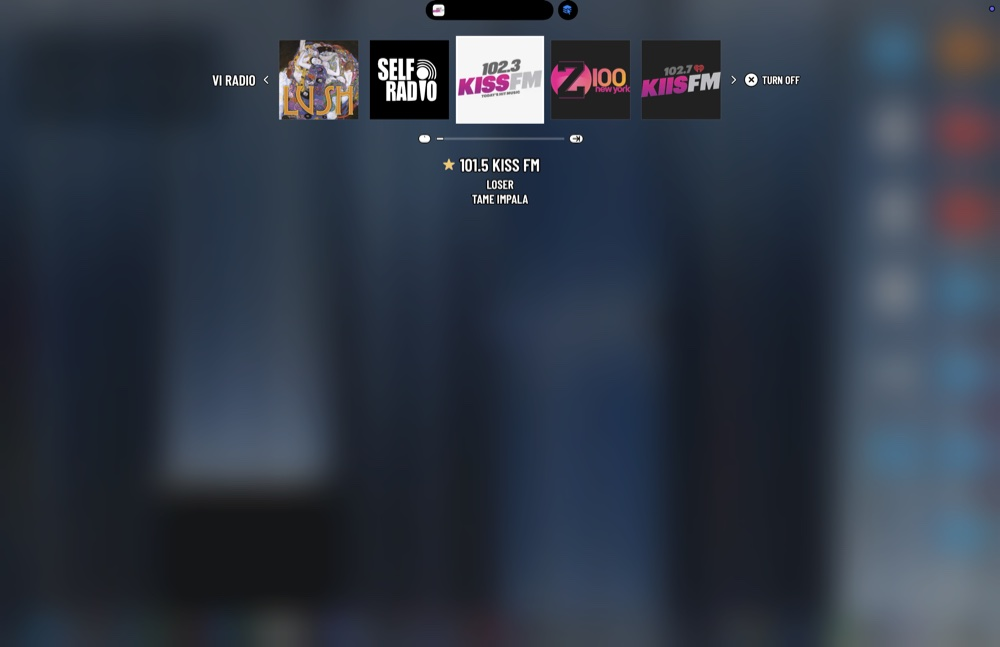
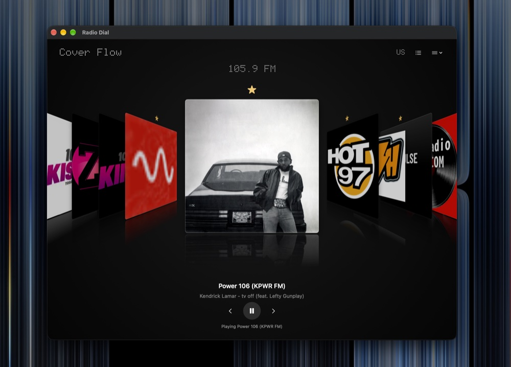
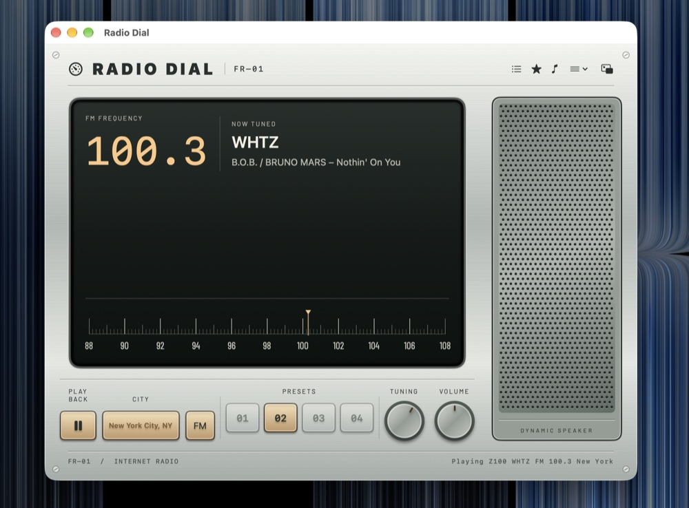
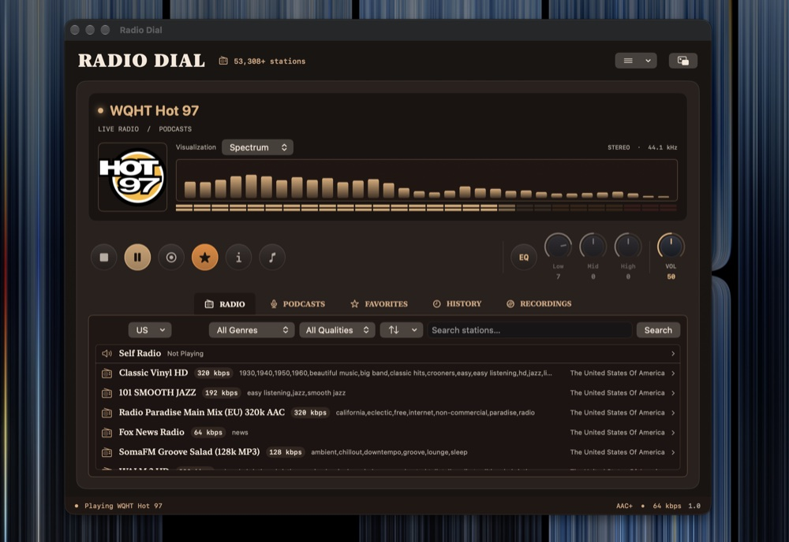

<div align="center">
  
</div>

<div align="center">
  <a href="https://raw.githubusercontent.com/rogeryeoh49-bot/Radio-DIAL/main/assets/screenshots/02.jpg"></a>
  <a href="https://raw.githubusercontent.com/rogeryeoh49-bot/Radio-DIAL/main/assets/screenshots/03.jpg"></a>
  <a href="https://raw.githubusercontent.com/rogeryeoh49-bot/Radio-DIAL/main/assets/screenshots/04.jpg"></a>
  <a href="https://raw.githubusercontent.com/rogeryeoh49-bot/Radio-DIAL/main/assets/screenshots/05.jpg"></a>
</div>

# Radio DIAL

Radio DIAL is a macOS app for listening to internet radio and podcasts worldwide. It includes different themes, live audio visualizers, recording and scheduling, a sleep timer, alarms, and song/lyrics identification. 

**ALL FREE**. It is impossible to find a pure radio player that doesn't ask you to spend money. At least, I've never found one on either iOS or macOS. Yes, so I made a pure radio player to give you access to completely free radio worldwide. Full of features to fit any needs.

## What’s new in v2.2.1

- **Self Radio** can follow audio from other apps and hand playback back to supported players.
- **Interactive setup** introduces the player, VI Radio shortcuts and optional permissions. Replay it from Settings.
- **Cover Flow and track metadata** handle more artwork formats and improve catalog matching.

[Read the full 2.2.1 release notes](https://github.com/rogeryeoh49-bot/Radio-DIAL/releases/tag/v2.2.1)

## What’s new in v2.2.0

- **VI radio**, a GTA VI–inspired global radio selector: hold **Option + Q**, browse a sliding row of station logos, and switch stations from another app.
- Immediate or confirmation-based playback, preloaded logos, favorite stars, loading indicators, a short selection sound and trackpad haptics.
- Customizable shortcuts for playback, recording, volume, mute and the mini player, with individual resets and Reset All.
- A saved default station country and restoration of the last source.

[Read the full 2.2.0 release notes](https://github.com/rogeryeoh49-bot/Radio-DIAL/releases/tag/v2.2.0) · [All releases](https://github.com/rogeryeoh49-bot/Radio-DIAL/releases)

## Install on Mac

Paste this line into Terminal on macOS 14 or later. It works on Apple silicon and Intel Macs.

```sh
curl -fsSL https://github.com/rogeryeoh49-bot/Radio-DIAL/releases/latest/download/install.sh | /bin/bash
```

The installer puts Radio DIAL in `~/Applications` and downloads a [standalone FFmpeg decoder](https://github.com/eugeneware/ffmpeg-static/releases/tag/b6.1.1) if needed for playback. Open it from that folder or run `open "$HOME/Applications/Radio Dial.app"`. You can also [download the app ZIP](https://github.com/rogeryeoh49-bot/Radio-DIAL/releases/latest) and provide your own FFmpeg. The app is locally signed and has not been notarized by Apple.

### If macOS blocks the app

Radio DIAL is not notarized by Apple, so macOS may show a security warning on first launch. If you downloaded Radio DIAL from this repository and want to open it, run:

```sh
xattr -dr com.apple.quarantine "$HOME/Applications/Radio Dial.app"
```

This removes macOS’s quarantine attribute from that copy of the app. If you installed it somewhere else, replace the path with the location of your Radio Dial.app. Then open the app again.

## Using Radio DIAL

**Settings → Shortcuts** lets you change playback, recording, volume, mute and mini-player shortcuts. Click a key to record a new binding; use its Reset button or Reset All to restore defaults. These shortcuts apply while Radio Dial is active. The VI radio global shortcut is configured separately in its own settings tab.

- Select a station to play it. Right-click rows for stream tests, favorites, podcast downloads and other actions.
- Use the record button to choose MP3, WAV, FLAC or Ogg, with optional splitting when the stream supplies new track metadata.
- Use the top-right menu for the sleep timer, alarms, scheduled recording, playlists, equalizer presets, themes, stream status and settings.
- Choose the FR-01 Receiver theme for AM/FM tuning, a US city selector, and four presets drawn from your favorite stations.
- Keep the app running and the Mac awake for scheduled actions. Radio Dial does not wake a sleeping Mac.
- Last.fm and Discord require your own service credentials or application ID in Settings.
- Settings and downloaded podcasts live under `~/Library/Application Support/Radio Dial`. The default recording folder is `~/Music/Radio Dial`.

### VI radio selector

Hold **Option + Q** from any app to open the full-screen VI radio selector. By default, navigating immediately plays the selected station; releasing the shortcut closes the selector. Favorites appear first and display a gold star to the left of the station name; a loading spinner appears on the right while connecting. VI radio uses a short selection tone and trackpad haptics instead of loading static; favorite stations give stronger feedback. Turn Off pauses playback and closes the selector. Song titles and artists appear on separate lines with matching typography. The current station remains available.

#### Shortcuts and playback modes

In **Settings → VI radio**, enable or disable the global shortcut, record a custom shortcut, or choose toggle mode. Station switching can play immediately (the default) or wait for Space, Return or a logo click. In confirmation mode, releasing the opening shortcut closes without confirming the preview. In press mode, press the shortcut once to open and again to close without changing playback; Return or click confirms a station.  

#### Navigation and artwork

Tab browses forward. The backtick key (above Tab) and Shift-Tab browse backward. Previous/next keys are customizable in VI radio settings. Space or Return confirms playback. Navigation hints appear after 5 seconds without key presses, clicks or scrolling. The hints hide again on those actions. Moving the mouse does not reset the timer. Caps Lock can still be assigned as a custom navigation key and retains its normal macOS behavior. Station logos preload around the current selection and stay cached between openings. You can also open the selector from **View** or the **VI radio** card in Themes.

#### macOS compatibility

The shortcut uses native macOS hotkey registration and requires no Accessibility or Input Monitoring permission. If another app or macOS has reserved the shortcut, choose another combination; the View and Themes entries remain available. The overlay opens on the screen containing the pointer and can join Spaces and full-screen apps where macOS permits it; protected system screens are excluded.

## In development

These updates are available on the [`main` branch](https://github.com/rogeryeoh49-bot/Radio-DIAL/tree/main).

### Interactive getting-started tour

The guided tour opens automatically for a new installation. Finish or skip it once, or replay it from **Help → Getting Started…** or **Settings → General → Getting Started…**. The tour points out station search, themes, Cover Flow controls, and Self Radio settings. It shows the VI radio shortcut in a full-screen prompt and lets you practice switching stations without interrupting playback.

### Self Radio

Self Radio displays music playing in other apps using real system-audio activity. Enable **Settings → General → Self Radio**: external music stops the radio stream and selects Self Radio; starting a station first pauses other music. Music/Spotify can supply song information and artwork, with the original black Self Radio logo as fallback. System audio detection requires macOS 14.2+ and System Audio Recording permission; Music/Spotify may also request Automation access. A private macOS media-control fallback helps with browsers but cannot control every application. See [Self Radio implementation and limitations](SELF_RADIO.md).

### VI radio backdrop

VI radio uses a live, full-window dark HUD material behind a separate black dimming layer. Settings → VI radio includes independent Blur strength and Darkness sliders, a live preview, and Reset background. Both values are remembered across launches; the defaults are 100% material strength and 0% darkness. Blur strength blends the native material with the desktop rather than setting a Gaussian radius. Station artwork and text stay in an independent, sharp foreground layer. Opening and closing use a 220 ms transition; Reduce Motion disables the foreground scale effect.

No screen capture, screen-recording permission or continuous screenshot loop is used. The blur strength belongs to macOS's native material and cannot be set to an exact Gaussian radius. Its appearance can vary with the macOS version and accessibility settings; Reduce Transparency may make the background opaque. This is the permission-free native implementation, not a guaranteed 30–50-point Gaussian defocus.

## Contributing
  
contribute different gorgeous themes or any other things, and help turn it into the No. 1 free radio player someday.

Contact me at [rogeryeoh49@gmail.com](mailto:rogeryeoh49@gmail.com).

### Build and run

Run `./build.sh` with the macOS Command Line Tools installed. It builds and locally signs `build/Radio Dial.app` for the current Mac. Use `./build.sh --universal` to build for Apple silicon and Intel. For a source build, install FFmpeg with Homebrew or set `FFMPEG_PATH`.

Song identification can use the optional recognition environment. Install it with the two commands below. Without it, the app tries ShazamKit, which requires catalog access in the app’s signing configuration.

```sh
python3.12 -m venv "$HOME/Library/Application Support/Radio Dial/Recognition"
"$HOME/Library/Application Support/Radio Dial/Recognition/bin/python" -m pip install shazamio==0.8.1 truststore==0.10.4
```

### Sparkle update releases

Radio Dial uses Sparkle for update checks. The General settings option controls automatic download and installation; automatic checks remain enabled when it is off. Before distributing the first Sparkle-enabled version, publish `appcast.xml` on the repository's `main` branch. Existing installations need to install that version once before they can receive Sparkle updates.

For every later release, increment both `CFBundleShortVersionString` and the numeric `CFBundleVersion` in `Info.plist`. Write release notes as an HTML fragment, then run `./prepare-update.sh path/to/notes.html`. Upload the generated ZIP to the matching GitHub release and publish the generated `appcast.xml` to `main` only after the ZIP is available. The Sparkle signing key is stored in the macOS Keychain under account `org.radiodial.macos`; preserve a secure backup of this private key. Never commit it to the repository. Build and test the update from an older installed Sparkle-enabled release before announcing it.

## License

Radio DIAL's original source code is available under the [MIT License](LICENSE).

The bundled [Barlow](Resources/Barlow-OFL.txt) and [Punctum](Resources/Punctum-OFL.txt) fonts are distributed under their respective SIL Open Font Licenses. Third-party media and branding are subject to their respective rights.
