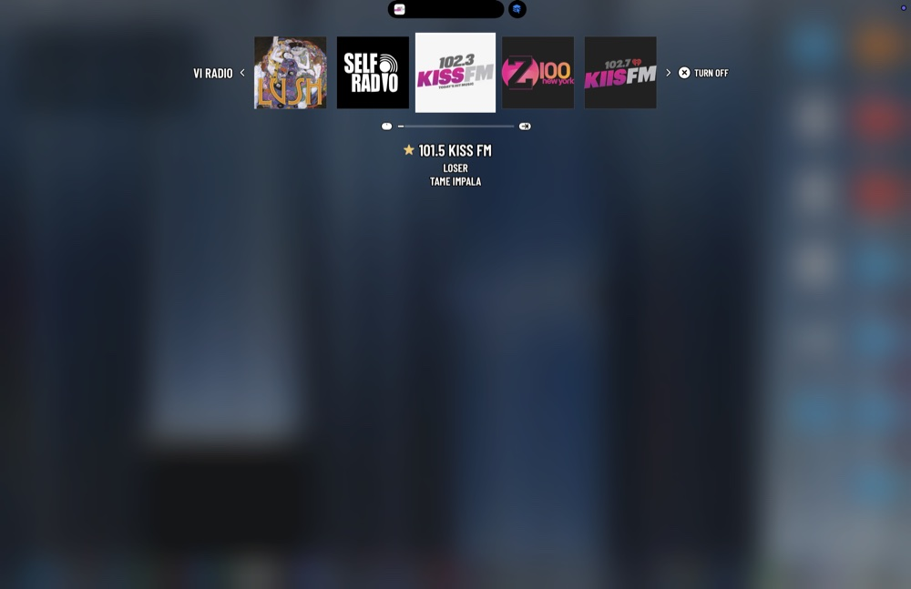
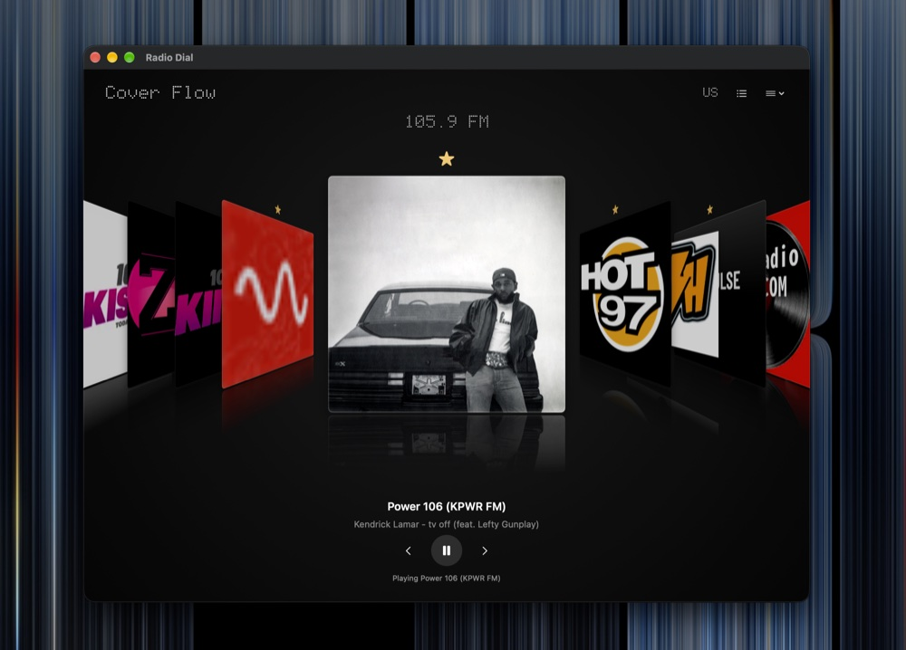
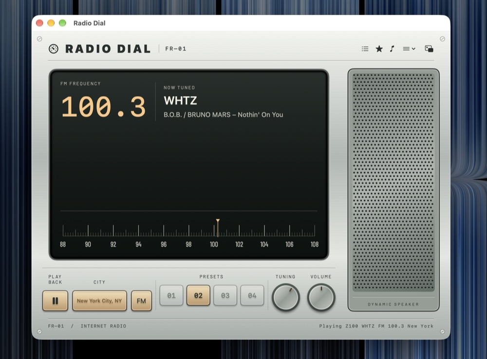
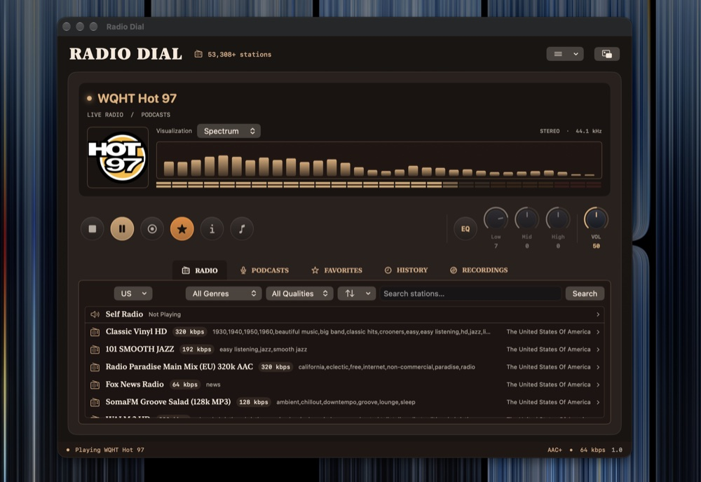

<div align="center">
  
</div>

<div align="center">
  <a href="https://raw.githubusercontent.com/rogeryeoh49-bot/Radio-DIAL/main/assets/screenshots/02.jpg"></a>&thinsp;<a href="https://raw.githubusercontent.com/rogeryeoh49-bot/Radio-DIAL/main/assets/screenshots/03.jpg"></a><br>
  <a href="https://raw.githubusercontent.com/rogeryeoh49-bot/Radio-DIAL/main/assets/screenshots/04.jpg"></a>&thinsp;<a href="https://raw.githubusercontent.com/rogeryeoh49-bot/Radio-DIAL/main/assets/screenshots/05.jpg"></a>
</div>

<div align="center"><a href="README.md">English</a> · <strong>简体中文</strong></div>

# Radio DIAL

Radio DIAL 是一款 macOS 应用，可以收听全球网络电台和播客。它提供多种主题、实时音频可视化、录音和定时任务、睡眠定时器、闹钟，以及歌曲和歌词识别。

**全部免费。** 我一直想找一款不用付费的纯电台播放器，至少在 iOS 和 macOS 上，我自己一直没找到。于是我就做了一个。你可以免费收听世界各地的电台，也可以按自己的习惯使用各种功能。

## v2.2.2 更新内容

- **设置：** 新增侧边栏，更容易找到播放、Self Radio、网络、隐私和快捷键设置。可以直接在「播放器」（Player）设置里预览主题。
- **Cover Flow：** 透明电台标志保留原有透明度，右上角菜单改为单个省略号图标。
- **程序坞图标：** 在 macOS 26 及以上版本，浅色和深色图标会跟随系统外观自动切换，即使 Radio DIAL 已退出。
- **使用统计：** 在「设置 → 隐私」管理是否分享统计数据。新安装默认开启分享，升级会沿用原有设置。

[查看完整的 2.2.2 发布说明](https://github.com/rogeryeoh49-bot/Radio-DIAL/releases/tag/v2.2.2)

## v2.2.1 更新内容

- **Self Radio** 可以跟随其他应用的音频，并将播放控制交还给支持的播放器。
- **交互式入门引导** 介绍播放器、VI radio 快捷键和可选权限，可以从设置重新打开。
- **Cover Flow 和曲目信息** 支持更多封面格式，并改进了曲库匹配。

[查看完整的 2.2.1 发布说明](https://github.com/rogeryeoh49-bot/Radio-DIAL/releases/tag/v2.2.1)

## v2.2.0 更新内容

- **VI radio** 是受 GTA VI 启发的全局电台选择器。按住 **Option + Q**，滑动浏览一排电台标志，在其他应用里也能切台。
- 支持立即播放或确认后播放，并提供标志预加载、收藏星标、加载指示、短提示音和触控板触感反馈。
- 播放、录音、音量、静音和迷你播放器的快捷键均可自定义，支持单项重置或全部重置。
- 可以保存默认的电台国家或地区，并恢复上次使用的音源。

[查看完整的 2.2.0 发布说明](https://github.com/rogeryeoh49-bot/Radio-DIAL/releases/tag/v2.2.0) · [所有版本](https://github.com/rogeryeoh49-bot/Radio-DIAL/releases)

## 在 Mac 上安装

在 macOS 14 或更新版本的「终端」中粘贴下面的命令。搭载 Apple 芯片和 Intel 处理器的 Mac 均可使用。

```sh
curl -fsSL https://github.com/rogeryeoh49-bot/Radio-DIAL/releases/latest/download/install.sh | /bin/bash
```

安装程序会把 Radio DIAL 放在 `~/Applications`，并在播放需要时下载[独立的 FFmpeg 解码器](https://github.com/eugeneware/ffmpeg-static/releases/tag/b6.1.1)。可以从该文件夹打开应用，或运行 `open "$HOME/Applications/Radio Dial.app"`。也可以[下载应用 ZIP](https://github.com/rogeryeoh49-bot/Radio-DIAL/releases/latest)，自行准备 FFmpeg。应用在本地签名，尚未通过 Apple 公证。

### 如果 macOS 阻止打开应用

由于 Radio DIAL 尚未通过 Apple 公证，首次启动时 macOS 可能会显示安全警告。如果你从本仓库下载了 Radio DIAL 并希望打开它，可以运行：

```sh
xattr -dr com.apple.quarantine "$HOME/Applications/Radio Dial.app"
```

这条命令会移除这一份应用的 macOS 隔离属性。如果应用装在其他位置，请换成 `Radio Dial.app` 的实际路径，然后再次打开应用。

## 使用 Radio DIAL

在 **设置 → 快捷键** 中可以修改播放、录音、音量、静音和迷你播放器的快捷键。点击某项快捷键即可录制新的组合键，可用该项的 Reset 或 Reset All 恢复默认设置。这些快捷键在 Radio DIAL 处于活动状态时生效。VI radio 的全局快捷键在其专用设置页单独配置。

- 选择电台即可播放。右键点击列表项，可以测试音频流、收藏或下载播客等。
- 点击录音按钮可选择 MP3、WAV、FLAC 或 Ogg。如果音频流提供曲目更新信息，还可以按曲目分段录制。
- 右上角菜单提供睡眠定时、定时任务、播放列表和设置。在「播放器」（Player）下可以找到主题与均衡器预设，在「网络」（Network）下可以找到音频流监视器（Stream Monitor）。
- 选择 FR-01 Receiver 主题可以使用 AM/FM 调谐、选择美国城市，并从收藏中选出四个预设电台。
- 定时任务需要应用保持运行、Mac 保持唤醒。Radio DIAL 无法唤醒睡眠中的 Mac。
- Last.fm 和 Discord 需要在设置中填写你自己的服务凭据或应用 ID。
- 设置和已下载的播客保存在 `~/Library/Application Support/Radio Dial`。默认录音文件夹为 `~/Music/Radio Dial`。

### VI radio 电台选择器

在任何应用里按住 **Option + Q**，即可打开全屏 VI radio 电台选择器。默认情况下，切换到某个电台时会立即播放，松开快捷键就会关闭选择器。收藏电台排在最前面，名称左侧有金色星标，连接时右侧会显示加载动画。选择电台时会有短提示音和触控板触感反馈，取代加载时的静电杂音，收藏电台的反馈更强。选择「Turn Off」会暂停播放并关闭选择器。歌名和艺人分行显示，使用一致的排版。当前电台仍可选择。

#### 快捷键和播放模式

在 **设置 → VI radio** 中，可以开关全局快捷键、录制自定义组合键，或选择切换模式。切台可以立即播放（默认），也可以等按下空格、回车或点击标志后再播放。在确认模式下，松开用于打开选择器的快捷键会关闭界面，预览中的电台不会被选中。在按键切换模式下，按一次打开，再按一次关闭，原有播放不受影响。用回车或点击确认电台。

#### 浏览和电台标志

按 Tab 向前浏览，按反引号键（Tab 上方的键）或 Shift + Tab 向后浏览。前进和后退键可在 VI radio 设置中修改。按空格或回车确认播放。连续 5 秒没有按键、点击或滚动时会显示导航提示，执行其中任一操作后提示会再次隐藏。移动鼠标不会重置计时。Caps Lock 可设为自定义导航键，并保留 macOS 原有行为。选择器会预加载当前电台附近的标志，并在关闭后保留缓存。你也可以通过 **View（视图）** 菜单或主题设置里的 **VI radio** 卡片打开选择器。

#### macOS 兼容性

快捷键使用 macOS 原生注册机制，无需辅助功能或输入监控权限。如果组合键已被其他应用或 macOS 占用，可以换一个，也可以继续从 View 菜单或主题设置打开选择器。界面在鼠标指针所在的屏幕上打开。在 macOS 允许的情况下，也可以覆盖其他桌面空间和全屏应用。受保护的系统界面除外。

## 开发中的功能

以下更新可在 [`main` 分支](https://github.com/rogeryeoh49-bot/Radio-DIAL/tree/main)查看。

### 交互式入门引导

新安装后会自动打开入门引导。你可以完成或跳过，也可以通过 **Help → Getting Started…** 或 **Settings → General → Getting Started…** 重新查看。引导会介绍电台搜索、主题、Cover Flow 控件和 Self Radio 设置，还会在全屏提示中展示 VI radio 快捷键，让你练习切台而不中断播放。

### Self Radio

Self Radio 通过实际的系统音频活动检测并显示其他应用正在播放的音乐。在 **设置 → Self Radio** 中启用后，其他应用开始播放音乐时，电台音频会停止并切换到 Self Radio。开始播放电台时，应用会先暂停其他音乐。音乐（Music）和 Spotify 可以提供歌曲信息和封面，取不到封面时会显示原来的黑色 Self Radio 标志。系统音频检测需要 macOS 14.2 或更新版本，以及系统音频录制权限。音乐和 Spotify 也可能要求「自动化」权限。应用还使用 macOS 的私有媒体控制接口作为浏览器的备用方案，能控制的应用有所限制。参见 [Self Radio 的实现与限制](SELF_RADIO.md)。

### VI radio 背景

VI radio 使用覆盖整个窗口的实时深色 HUD 材质，上方叠有独立的黑色调暗层。「设置 → VI radio」提供独立的模糊强度和暗度滑块、实时预览和背景重置。两项数值会在应用重启后保留，默认分别为 100% 材质强度和 0% 暗度。模糊强度控制原生材质与桌面画面的混合比例。电台封面和文字位于独立的清晰前景层。打开和关闭时有 220 毫秒的过渡动画，启用「减弱动态效果」会关闭前景缩放。

背景无需截屏、屏幕录制权限或持续截图。模糊程度由 macOS 原生材质决定，无法指定精确的高斯模糊半径，也无法保证达到 30–50 点的高斯模糊效果。外观可能随 macOS 版本和辅助功能设置而变化，启用「降低透明度」可能使背景变成不透明。

## 参与贡献

欢迎贡献你喜欢的主题，或者加入其他功能，一起把 Radio DIAL 做成最好用的免费电台播放器。

联系邮箱：[rogeryeoh49@gmail.com](mailto:rogeryeoh49@gmail.com)。

### 构建和运行

将开发工具链设为 Xcode 26 或更新版本后，运行 `./build.sh`。构建脚本会编译用于 macOS 26 及以上版本的浅色和深色程序坞图标，并为当前 Mac 构建及本地签名 `build/Radio Dial.app`。运行 `./build.sh --universal` 可同时支持 Apple 芯片和 Intel。若从源码构建，请通过 Homebrew 安装 FFmpeg，或设置 `FFMPEG_PATH`。

如果开发构建无需连接共享的使用统计端点，可以运行 `./build.sh --debug` 或 `RADIO_DIAL_USAGE_URL= ./build.sh`。

歌曲识别可以使用可选的识别环境。运行下面两条命令即可安装。未安装时，应用会尝试使用 ShazamKit，这要求应用的签名配置有曲库访问权限。

```sh
python3.12 -m venv "$HOME/Library/Application Support/Radio Dial/Recognition"
"$HOME/Library/Application Support/Radio Dial/Recognition/bin/python" -m pip install shazamio==0.8.1 truststore==0.10.4
```

### 通过 Sparkle 发布更新

Radio DIAL 使用 Sparkle 检查更新。「通用」设置中的选项控制是否自动下载和安装。关闭该选项后，应用仍会自动检查更新。分发首个支持 Sparkle 的版本前，请先将 `appcast.xml` 发布到仓库的 `main` 分支。现有用户需要先安装一次该版本，之后才能收到 Sparkle 更新。

以后每次发布新版本时，都要递增 `Info.plist` 里的 `CFBundleShortVersionString` 和数字版的 `CFBundleVersion`。将发布说明写成 HTML 片段，再运行 `./prepare-update.sh path/to/notes.html`。把生成的 ZIP 上传到对应的 GitHub Release，待 ZIP 可下载后，再将生成的 `appcast.xml` 发布到 `main`。Sparkle 签名密钥保存在 macOS 钥匙串的 `org.radiodial.macos` 账户下。请安全备份私钥，切勿提交到仓库。对外发布前，请从已安装的较旧 Sparkle 版本实际测试一次更新。

## 许可证

Radio DIAL 的原创源代码采用 [MIT 许可证](LICENSE)。

随应用附带的 [Barlow](Resources/Barlow-OFL.txt) 和 [Punctum](Resources/Punctum-OFL.txt) 字体分别依照各自的 SIL 开源字体许可证分发。第三方媒体和品牌标识的权利归各自权利人所有。
